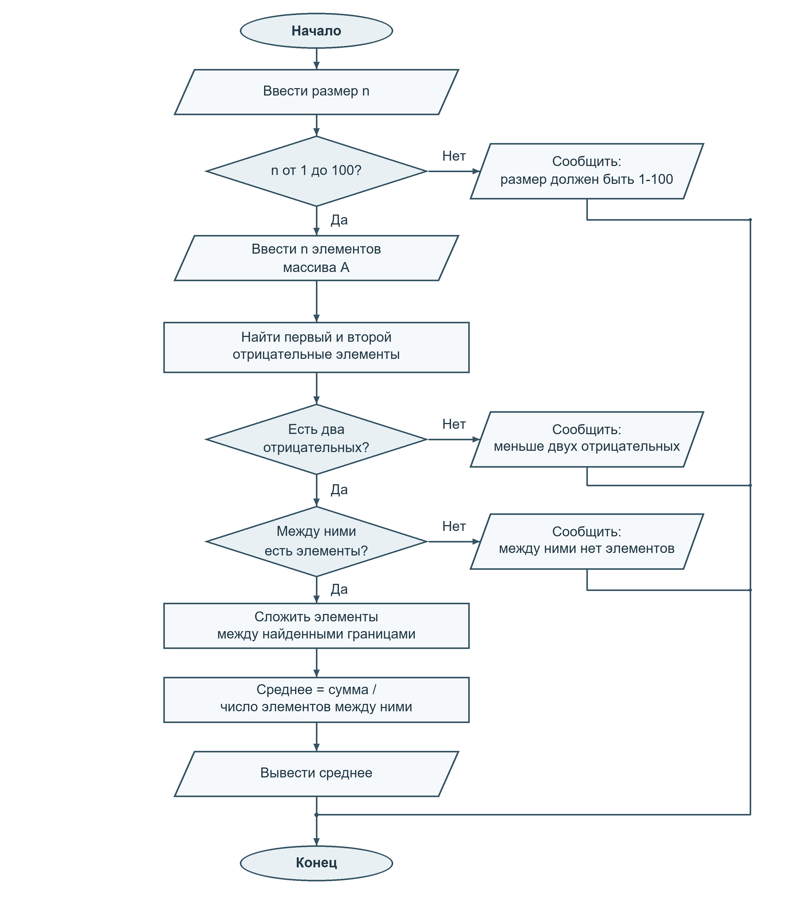

# Лабораторная работа №11
## Вариант 6. Работа с одномерным массивом
Найти среднее арифметическое элементов массива, расположенных между
первым и вторым отрицательными элементами.
Сами отрицательные элементы в расчёт не входят.
## Блок-схема

На схеме отдельными блоками показаны ввод массива, поиск границ,
проверки, вычисление суммы и среднего. Циклы ввода и поиска обозначены
укрупнёнными блоками с короткими подписями.
